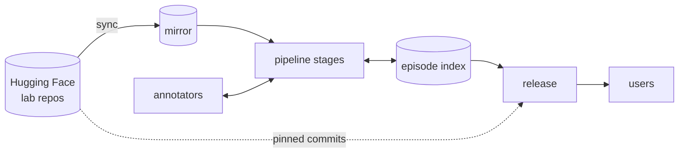

# Oopsie backend

Oopsie-Data collects robot episodes, successes and failures, from many labs. Each lab uploads its episodes as HDF5 files with camera videos to its own dataset repo in the `OopsieData-Submissions` organization on Hugging Face. The backend turns these uploads into curated data: it catalogs every episode, checks the data, holds out a test set, has the episodes labeled by annotators, and publishes versioned releases.

## Get the data *(start here)*

Ask the Oopsie-Data team for a read-only Hugging Face token, then:

```bash
git clone https://github.com/oopsie-data/oopsie-backend.git && cd oopsie-backend
uv sync                                                     # install
export HF_TOKEN=<your read-only token>
uv run oopsie ingest release list                           # the published releases
uv run oopsie ingest sync --release 2026-11-08 --data-dir /path/to/data
```

```python
import polars as pl
df = pl.read_parquet("/path/to/data/releases/2026-11-08/episode_index.parquet")
```

Next: [Download a release](using/download.md) for what the download contains, and [Reading the index](using/reading-the-index.md) for selecting episodes and finding their files.

## Run the full pipeline *(heavy, many steps)*

```bash
uv sync                                     # install
uv run oopsie pipeline run --list           # targets and their stages
uv run oopsie pipeline run qa --explain     # run a target and every stage it needs
uv run oopsie                               # every command, by command group
```

The defaults in `configs/pipeline.yaml` are the LS6 paths: the mirror in `/corral/utexas/IRI26024/oopsiedata`, the index in `/corral/utexas/IRI26024/episode_index/`.

Next: the [pipeline quickstart](pipeline/quickstart.md), the [overview](pipeline/index.md) of the mirror, the index and the stages, and the [LS6 runbook](operations/ls6.md) for the nightly job.

## Key concepts

| Term | Meaning |
|---|---|
| **Release** | a frozen, tagged version of the dataset, e.g. `2026-11-08`: the pinned commit of every lab repo and the index built from those files. What users download. |
| **Mirror** | the team's full local copy of every lab repo, on LS6. The pipeline reads it. |
| **Episode index** | one table, `episode_index.parquet`, with one row per episode and every result as a column. Each release ships one. |
| **Command group** | a set of commands named after a code folder, run as `oopsie <group> <command>`, e.g. `oopsie ingest sync`. |
| **Stage** | one step of the pipeline. It calls a command's code and writes its result to the index or to files. |
| **Target** | a named set of stages. `oopsie pipeline run <target>` runs them, and first any stage they depend on that is out of date. |
| **Pipeline** | every stage chained together. The Oopsie-Data team runs it to build the index and publish releases; most users only need a release. |

Command groups follow the code folders and targets follow the order of a run, so a name like `index` can be both, with different contents. [Running commands](pipeline/running-commands.md) explains how they map.

## The pipeline in brief

A nightly job on TACC's LS6 cluster mirrors the labs' repos, builds the index from the h5 files, finds duplicates, runs quality checks, computes stats, holds out the eval split, distributes episodes to annotators and collects their labels. Every result lands in the index. When the data is in a good state, the team publishes it as a release.



[Pipeline overview](pipeline/index.md) explains the design, and [Running](pipeline/running.md) how to run them.

## Where to look things up

| You want to | Read |
|---|---|
| look up an index column or a config file | [Index columns](reference/index-columns.md), [Configs](reference/configs.md) |
| find a command | [All commands](pipeline/running-commands.md#all-commands) |
| coordinate the annotators | [Annotation](pipeline/annotation/index.md) |
| annotate episodes | [Annotator guide](pipeline/annotation/annotator-guide.md) |
| build a training set | [Training data](pipeline/training-data.md) |
| add a stage, a QA check or a converter | [Development](development.md) |
