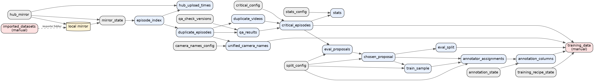

# Pipeline quickstart

How to run the pipeline by hand. Full reference: [pipeline.md](pipeline.md).

## Terms

- **Stage**: one step, a function marked `@stage`. Its parameters are what it depends on (other stages or config values). Results are cached and rerun only when its code or inputs change.
- **Package**: where a stage's code lives (`oopsie_backend/<package>/stages.py`). You never run a package.
- **Target**: a named group of stages that you pass to `oopsie pipeline run`. A stage name works as a target too.

Running a target also runs every stage it depends on that isn't cached.

Every stage returns a fingerprint (a short hash), and the cache compares fingerprints to decide what to rerun. Stages come in two kinds:

- **Workers** change data (index columns, reports, files) and return a fingerprint of what they wrote. They are cached: skipped when their inputs are unchanged. Exceptions: `hub_mirror` and `imported_datasets` run every time, because only they can tell whether there is new data to fetch or convert.
- **Watchers** (`mirror_state`, `camera_names_config`, `qa_check_versions`, `critical_config`, `stats_config`, `split_config`, `annotation_state`, `training_recipe_state`) change nothing and return a fingerprint of outside state, such as a config file or the h5 files on disk. They run every time (`@stage(always_run=True)`), so when that state changes, the worker after them sees a new input and reruns. The cache can't see files on its own; watchers are how it notices.

The stages table below lists workers only; its "Runs when" column says what each one's watcher checks.

## Run

```bash
uv run oopsie pipeline run all --config configs/pipeline.yaml --explain   # everything (the nightly job)
uv run oopsie pipeline run --list                                         # targets and their stages
```

Add `--set use_hub=false` to skip the Hub sync, `--no-cache` to force every stage to rerun.

## Stages

In run order, grouped by target. "(dependency)": the target doesn't name the stage, but runs it because a stage it names needs it. A cached stage also reruns whenever a stage above it that it depends on changed its output.

Paths are set in `configs/pipeline.yaml` (values on LS6):

- `<data>`: `data_dir`, the mirror root (`/corral/utexas/IRI26024/oopsiedata`)
- `<index>`: `index_path` (`/corral/utexas/IRI26024/episode_index/episode_index.parquet`)
- `<reports>`: `reports_dir` (`/corral/utexas/IRI26024/reports`)
- `<training>`: `training_dir` (`/corral/utexas/IRI26024/training`)

| Stage | Target | Does | Runs when |
|---|---|---|---|
| `imported_datasets` | `imports` | converts the `converter:` entries of `configs/imports.yaml` (`hub:` entries are synced by `hub_mirror`). Writes `<data>/imports/<name>/` | **manual**; converts only missing ones |
| `hub_mirror` | `sync` | downloads new and changed files from the Hub. Writes h5 and video files to `<data>/<org>/<repo>/`, the download record `<data>/.sync_state.parquet`, failures and files gone from the Hub to `<data>/.sync_report.json` | **every run**; no-op with `use_hub=false` |
| `episode_index` | `index` | reads the h5 files and the Hub listing. Writes `<index>` (creates it if missing; core columns: metadata, file references, Hub hashes, `content_hash`) | h5 files, `repositories.yaml` or `imports.yaml` changed, or no index yet |
| `hub_upload_times` | `index` | finds when each episode reached the Hub. Writes `<index>` (columns `hub_uploaded_at`, `hub_upload_commit`), git histories to `<data>/.hub_history/` | sync record or index changed |
| `duplicate_episodes` | `preqa` | flags duplicate episodes. Writes `<index>` (columns `duplicate_of`, `duplicate_reasons`, `duplicate_group`) | index changed |
| `duplicate_videos` | `preqa` | flags videos shared between episodes or cameras. Writes `<index>` (columns `video_duplicates`, `has_duplicate_video`) | duplicates changed |
| `unified_camera_names` | `preqa` | maps camera names to a common set. Writes `<index>` (columns `unified_cameras`, `camera_name_issues`) | `camera_names.yaml` changed |
| `qa_results` | `qa` | runs QA checks. Writes `<index>` (`qa_*` columns), `<reports>/action_qa.html` | check versions or sampling changed; runs only missing or outdated checks |
| `critical_episodes` | `postqa` | flags unusable episodes. Writes `<index>` (columns `critical`, `critical_reasons`) | `critical.yaml` changed |
| `stats` | `stats` | computes dataset stats. Writes `../oopsie-docs/docs/assets/data/stats.json` (website), `<reports>/public_stats.json` and `.html`, `<reports>/internal_stats.json` and `.html` | `stats_config.yaml` changed |
| `eval_proposals` | `proposals` | proposes candidate eval splits. Writes `<data>/annotation/proposals/` (one JSON per proposal, `REPORT.md`) | `eval_split.yaml` changed |
| `chosen_proposal` | `splits` (dependency) | freezes the chosen proposal. Writes `<data>/annotation/eval_proposal.json` | **waits for you** to set `chosen_proposal` in `eval_split.yaml`; write-once |
| `train_sample` | `splits` | samples train episodes to annotate. Writes `<data>/annotation/train_annotation_sample.json` | write-once |
| `eval_split` | `splits` | marks eval episodes. Writes `<index>` (columns `eval_split`, `eval_proposal`) | chosen proposal changed |
| `annotator_assignments` | `annotation` (dependency) | assigns episodes to annotators. Writes `<data>/annotation/eval_assignment/`, `<data>/annotation/train_assignment/` | **waits for you** to fill `<data>/annotation/annotators.txt`; write-once |
| `annotation_columns` | `annotation` | pulls annotations into the index. Writes `<index>` (`annotation_*` columns) | annotation config or stores changed |
| `training_data` | `training` | materializes a training set. Writes `<training>/<recipe>/`, `<index>` (column `training_sets`) | **manual**; recipe changed |

Write-once outputs are never rewritten; if their settings change the run fails. Delete the output and its `.inputs` file to regenerate.

## Targets

| Target | Stages |
|---|---|
| `all` | everything except manual stages |
| `sync` | `hub_mirror` |
| `index` | `episode_index`, `hub_upload_times` |
| `preqa` | `duplicate_episodes`, `duplicate_videos`, `unified_camera_names` |
| `qa` | `qa_results` |
| `postqa` | `critical_episodes` |
| `stats` | `stats` |
| `proposals` | `eval_proposals` |
| `splits` | `eval_split`, `train_sample` |
| `annotation` | `annotation_columns` |
| `imports` | `imported_datasets` |
| `training` | `training_data`; needs `--set training_recipe=configs/training/<recipe>.yaml` |

## Graph



Blue: cached stages. Grey: run every time and check outside state (files, configs). Red: manual. Yellow: storage.
Regenerate after editing the source: `dot -Tpng docs/images/pipeline.dot -o docs/images/pipeline.png`.

## The mirror

- **`hub_mirror`**: downloads new and changed files from the Hugging Face org repos into the local mirror. Failed repos go to `.sync_report.json`; the run continues.
- **local mirror**: the on-disk copy of the Hub data (`data_dir`), plus local imports under `imports/`. Files deleted on the Hub are kept unless synced with `--delete-removed`.
- **`mirror_state`**: hashes every h5 file's path, size and modification time, plus the repo and import configs. If the hash is unchanged, the index and everything after it come from the cache.

## Cache and hashes

Two levels skip work:

- **Pipeline cache** (`cache_dir` in `configs/pipeline.yaml`): a store, not a hash. `metadata_store.db` (SQLite) records, per stage, a version of its code and the fingerprints of its inputs; the result files hold what each stage returned. A stage is skipped when its code and input fingerprints match an earlier run.
- **Index build**: once `episode_index` runs, it re-reads only the h5 files whose `h5_size` or `h5_mtime_ns` differ from their row in the index, or that have no row yet.

Other hashes in `episode_index.parquet` are data, not caching:

| Column | What | Used for |
|---|---|---|
| `episode_key` | sha1 of `<repo>/<path>`, 16 hex chars | row ID |
| `content_hash` | sha256 of the action and state arrays | finding duplicate episodes |
| `h5_sha256`, `h5_git_oid` | the Hub's hashes of the h5 | comparing with the Hub |
| `videos` (hashes inside) | the Hub's hashes per camera video | finding shared videos |
