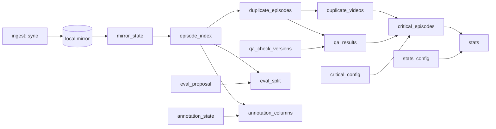

# Pipeline

The backend is split into stages that read and extend the [episode index](episode-index.md). [Hamilton](https://hamilton.apache.org/) runs them: it computes the stages a target needs, runs independent stages in parallel, and takes a stage from its cache when the stage's code and inputs are unchanged since its last run.



| Stage | Package | Writes |
|---|---|---|
| `episode_index` | `index` | core columns: h5 metadata, file references, Hub hashes, content hash |
| `duplicate_episodes` | `preqa` | `duplicate_of`, `duplicate_reasons`, `duplicate_group` |
| `duplicate_videos` | `preqa` | `video_duplicates`, `has_duplicate_video` |
| `qa_results` | `qa` | `qa_*` columns, `reports/action_qa.json` and `.html` |
| `critical_episodes` | `postqa` | `critical`, `critical_reasons` |
| `stats` | `stats` | website `stats.json`, `reports/public_stats.*`, `reports/internal_stats.*` (with critical episodes per lab) |
| `eval_split` | `splits` | `eval_split`, `eval_proposal` |
| `annotation_columns` | `annotation` | `annotation_*` columns |

`mirror_state`, `qa_check_versions`, `critical_config`, `stats_config`, `eval_proposal` and `annotation_state` run on every invocation. Each of them hashes outside state: the h5 files on disk and `configs/repositories.yaml`, the QA check versions, a config file, the chosen proposal, or the annotation assignments and stores. A downstream stage reruns only when one of those hashes changes. The sync itself runs outside the pipeline, because it is the job that changes the mirror.

## Running

```bash
uv run oopsie pipeline run nightly --config configs/pipeline.yaml --explain
uv run oopsie pipeline run qa                    # one target and everything it needs
uv run oopsie pipeline run --list                # targets and stages
uv run oopsie pipeline run postqa --graph dag.png
```

| Target | Stages |
|---|---|
| `index` | `episode_index` |
| `preqa` | `duplicate_episodes`, `duplicate_videos` |
| `qa` | `qa_results` |
| `postqa` | `critical_episodes` |
| `stats` | `stats` |
| `splits` | `eval_split` |
| `annotation` | `annotation_columns` |
| `nightly` | `stats` (and everything before it) |

`configs/pipeline.yaml` holds every input a stage may need: the mirror, the index, the cache directory, the worker count, whether to query the Hub, the reports directory, the website `stats.json`, the chosen proposal and the annotation config.

Flags:

- `--explain` prints which stages ran and which came from the cache.
- `--set KEY=VALUE` (repeatable) overrides a config input; the nightly job uses it to pass its own paths.
- `--no-cache` runs every requested stage.
- `--serial` runs stages one at a time.

Every stage also exists as a command (`oopsie <stage> <command>`, see `oopsie` without arguments), so it can be run directly with its own options.

The nightly Slurm job syncs the mirror and then runs `nightly`.

Downstream stages ignore duplicate copies and critical episodes. QA, the duplicate-video check and the critical flags skip copies. Split planning, the annotated train sample and the stats skip both copies and critical episodes, so the stats run after QA and the critical flags.

## Stages and the registry

A stage is a function registered with `@stage` in `<package>/stages.py`:

```python
@stage
def duplicate_videos(episode_index: str, index_path: str) -> str:
    check_rc(dv.main(["--index", index_path]), "duplicate videos")
    return columns_fingerprint(Path(index_path), dv.COLUMNS)
```

Its parameters are the stages or config inputs it depends on. It writes its results to the index and returns a fingerprint of what it wrote; Hamilton caches that fingerprint and compares it with the last run. `@stage(always_run=True)` marks a stage that observes outside state.

`oopsie_backend/pipeline/stages.py` imports every stage module by name and defines the targets. To add a stage, write the function, import its module there, and add any new input to `configs/pipeline.yaml`.

Hamilton versions a stage by its own source code only. A change in the code a stage calls is caught by the stage's inputs: the index stages see changed files, and QA sees changed check versions. For other code changes, run the target with `--no-cache` once.

## QA checks

QA has its own registry, one level down: `qa/checks/registry.py` imports every check, one file per check, each registered with `@check`. Results are stored per episode and per check, together with the check's version. A QA run therefore runs only the checks whose result is missing or outdated, as described in [action checks](action-checks.md#running-and-adding-checks).

## Critical episodes

`configs/critical.yaml` lists what makes an episode critical:

- an unreadable h5;
- a video file shared with another episode or camera;
- optionally, a QA error;
- findings of the listed QA checks.

The default list covers checks that make an episode structurally unusable: misaligned or misshaped actions, a missing state, wrong joint counts, missing or undecodable videos, and frozen video while the robot moves. Episodes that QA has not sampled can only be critical through the first three conditions. Duplicate copies are never critical; they are skipped. The internal report lists critical episodes per lab and in total, with their reasons.
