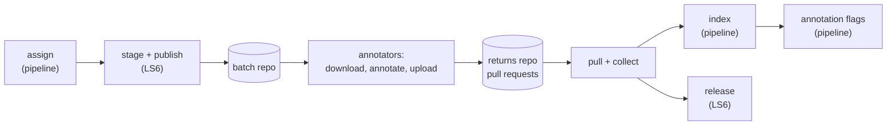

# Annotation

Annotators label the [eval split](../eval-split.md) and the [train sample](../train-sample.md) independently of the labs: the outcome, failure categories and severity, and temporal segments that mark when a failure happens. Each eval episode is labeled by two or three annotators, so their agreement can be measured.

The episodes reach the annotators as two batches in a private Hugging Face repo: `batch_1` holds the eval assignment and `batch_2` the train sample. Annotators see only the batch names, so they cannot tell which batch is eval.



The pipeline covers the assignment and moves the collected labels into the index. Publishing the batches and collecting the returns are commands the coordinator runs, because they involve the annotators and the Hub.

| Stage | Target | Runs after | Writes |
|---|---|---|---|
| `annotator_assignments` | `annotation` | `chosen_proposal`, `train_sample`; waits for `<data_dir>/annotation/annotators.txt` | `annotation/eval_assignment/`, `annotation/train_assignment/`, written once |
| `annotation_columns` | `annotation` | `annotator_assignments`, `annotation_state` | `annotation_*` columns |
| `annotation_flags` | `annotation` | `annotation_columns` | see [annotation flags](flags.md) |

## Files

Everything lives in `/corral/utexas/IRI26024/oopsiedata/annotation/`, next to the mirror's org folder, so every run on LS6 sees it. The index build only reads the org folder, so nothing here is indexed as data. `configs/annotation_pipeline.yaml` names the two Hugging Face repos and these paths, relative to `annotation/`.

| File | Contents |
|---|---|
| `annotators.txt` | the annotators, one name per line |
| `eval_assignment/`, `train_assignment/` | the assignments, the only mapping from the blinded episode ids back to the source episodes |
| `annotation_repo/` | the staged batch repo |
| `returns/` | downloaded pull requests; `collect` can be rerun from them |
| `eval_annotations.jsonl`, `train_annotations.jsonl` | append-only stores of every collected annotation |
| `eval_release/`, `train_release/` | source episodes with the collected annotations added |

Never regenerate the assignments once the batches are published: a new assignment puts different episodes at the positions the annotators are working through.

## Assignments

Once `annotators.txt` exists, `annotator_assignments` assigns every eval episode to `copies` distinct annotators (two by default, three for `od_task_od_scene`) and every train sample episode to one, as set under `assignments` in `configs/eval_split.yaml`.

Copies are assigned one at a time, to keep every annotator's workload balanced and every pair of annotators comparable:

1. Among annotators whose load is within one of the lowest, the copy goes to the one with the fewest episodes of that split, lab and task.
2. Ties go to the annotator who shares the fewest episodes with those already assigned to this episode, which spreads overlap evenly over annotator pairs.

Each annotator's list is then shuffled so that the same lab rarely appears twice in a row. The same seed and inputs give the same assignment. The output holds one ordered list per annotator, `samples.csv` with the annotators of each episode, and `assignment_summary.json` with loads and pair overlaps.

## Distributing

On LS6:

```bash
P="uv run oopsie annotation pipeline --config configs/annotation_pipeline.yaml"
$P stage
$P publish
```

`stage` packages every batch into `annotation_repo/`, with one folder per annotator and a `README.md` listing annotators, folders, episode counts and the commands annotators run. It exits non-zero if an episode lacks its h5 or videos, and still packages the rest.

The packaged copies are blind, so that the lab's labels and the policy cannot bias the annotator:

- the lab's `episode_annotations`, `source_data`, `source_*` attributes and `previous_episode_id` are removed;
- `policy_name` is set to `redacted`;
- `episode_id` is replaced by a stable hash of the source episode;
- files are named by position (`0001.h5`), so the annotation tool shows them in assignment order.

`publish` creates the batch repo and an empty returns repo as private datasets and uploads the staged folder. It refuses to upload if either repo exists and is public. Check on Hugging Face that the repo is private and the README is complete, give every annotator's account read access to both repos, and send them the [annotator guide](annotator-guide.md).

Before announcing new repos, run one episode through the whole loop yourself: download a folder, annotate an episode, upload it, then `pull` and `collect`. This confirms that returns are accepted.

## Collecting

Annotators return their work as pull requests on the returns repo. Run this loop as returns arrive; every step skips what it has already done:

```bash
$P pull       # --close closes collected pull requests
$P collect
$P status
```

`pull` downloads the annotated files of each pull request to `returns/pr_NNNN/`, with the manifests of the touched batches. It rejects a pull request that touches more than one annotator folder or changes anything other than episode `.h5` files; rejected ones appear in `status` and `returns/pull_requests.json`, and the annotator should upload again. Pull requests never need to be merged.

`collect` verifies every pulled file before it adds it to the store. A file passes when:

- its folder's manifest names the same annotator and lists the file's `episode_id` at its position;
- the assignment gives that annotator the same episode at that position;
- the `episode_id` matches exactly one index row;
- its action and state arrays hash to that row's `content_hash`, so the file was not altered.

Rejected files are listed in `returns/<batch>_verification.json`; `verify` runs the check alone. The stores are append-only and keyed by content: collecting the same return twice adds nothing, and a changed annotation is added as a new revision, of which the latest counts.

`status` prints returned against assigned annotations per annotator and batch. `eval_annotations_summary.json` and `train_annotations_summary.json` add missing episodes per annotator and outcome agreement.

## Index

`collect` ends by writing the stores to the index, and the `annotation_columns` stage does the same whenever the stores change. Each episode gets `annotation_records`, one record per annotation with the annotator's labels, segments as frame indices, and the `content_hash` of the copy the annotator labeled. Train sample annotations of an episode that the eval batch holds out are dropped. The [column reference](../../reference/index-columns.md#annotation) lists the fields.

The index is the merged view of all annotators' work, and the source h5 files are never changed. An annotation applies to an episode only while its `content_hash` equals the episode's: if the lab re-uploads a changed episode, the old labels no longer count. Training and the [dataset analysis](../analysis.md) read the annotations from the index, and the [annotation flags](flags.md) find the problems annotators reported in their notes.

## Release

On LS6, after copying the stores there:

```bash
$P release
```

This writes `eval_release/` and `train_release/`: copies of every annotated source episode with its videos, with each collected annotation added as its own `episode_annotations` group, named after the annotator. The lab's own annotations are kept. Rerunning after more returns rewrites only the changed groups.

## Commands

| Command | Where | Does |
|---|---|---|
| `stage` | LS6 | packages both batches |
| `publish` | anywhere | creates the private repos and uploads the batches |
| `pull` | anywhere | downloads returned pull requests |
| `verify` | anywhere | checks returned files against manifests, assignments and the index |
| `collect` | anywhere | verifies and adds returns to the stores, then writes the index |
| `status` | anywhere | progress per annotator |
| `index` | anywhere | writes the assignments and collected annotations to the index |
| `release` | LS6 | builds the annotated release copies |

All commands read and write `annotation/`. To work on a copy elsewhere, pass `--data-dir <folder holding annotation/>` and `--index <index>`.
