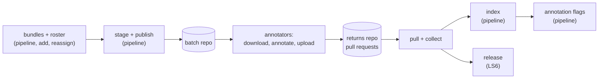

# Annotation

Annotators label the [eval split](../eval-split.md) and train episodes independently of the labs: the outcome, failure categories and severity, and temporal segments that mark when a failure happens. Each eval episode is labeled by two or three annotators, so their agreement can be measured. The annotated train set grows as annotators join.

The episodes reach the annotators in **bundles**: fixed, ordered lists of eval or train episodes. A bundle is final once built; it can move to another annotator, but its episodes and their order never change. Each annotator's folder in a private Hugging Face repo holds their bundles as `batch_1`, `batch_2`, and so on. Annotators see only these batch names, so they cannot tell which bundles are eval.



The pipeline builds the bundles, publishes them to the batch repo, collects the returns and moves the collected labels into the index. Adding bundles by hand and reassigning them are commands the coordinator runs.

| Stage | Target | Runs after | Writes |
|---|---|---|---|
| `annotation_bundles` | `annotation` | `chosen_proposal`, `train_sample`, `annotation_roster`; waits for `<data_dir>/annotation/annotators.txt` | `annotation/bundles/` |
| `annotation_publish` | `annotation` | `annotation_bundles`; needs `use_hub` | the batch repo, `annotation/annotation_repo/` |
| `annotation_collect` | `annotation` | `annotation_bundles`, `episode_index`; runs every time | `annotation/returns/`, the annotation stores |
| `annotation_columns` | `annotation` | `annotation_bundles`, `annotation_state` (after `annotation_collect`) | `annotation_*` columns |
| `annotation_flags` | `annotation` | `annotation_columns` | see [annotation flags](flags.md) |

## Files

Everything lives in `/corral/utexas/IRI26024/oopsiedata/annotation/`, next to the mirror's org folder, so every run on LS6 sees it. The index build only reads the org folder, so nothing here is indexed as data. `configs/annotation_pipeline.yaml` names the two Hugging Face repos and these paths, relative to `annotation/`.

| File | Contents |
|---|---|
| `annotators.txt` | the registered annotators, one name per line |
| `train_annotators.txt` | optional; `<name>: <number>` lines, the number of train episodes each listed annotator should hold |
| `eval_assignment/`, `train_assignment/` | the first assignment of the eval split and the train sample, one list per annotator |
| `bundles/<id>.json` | one bundle each: its kind (`eval` or `train`) and its episodes by position |
| `bundles/roster.jsonl` | who holds each bundle, and under which batch name; the only mapping, with the bundles, from the blinded episode ids back to the source episodes |
| `annotation_repo/` | the staged batch repo |
| `returns/` | downloaded pull requests; `collect` can be rerun from them |
| `eval_annotations.jsonl`, `train_annotations.jsonl` | append-only stores of every collected annotation, one per bundle kind |
| `eval_release/`, `train_release/` | source episodes with the collected annotations added |

Never edit or delete a bundle or a roster line: the annotators work through the bundles by position, and the roster decides which returns are accepted.

## Bundles and the roster

`bundles/roster.jsonl` is an append-only log. Each line gives a bundle to an annotator under a batch name, with a time and a note. A bundle's last line names its current holder. Earlier lines stay valid, so annotations a former holder returns are still accepted and kept. Within an annotator's folder, batch names are numbered upward and never reused. Two rules hold for every bundle an annotator is given, whether new or reassigned:

- the annotator has never held a bundle that shares an episode with it, so nobody labels an episode twice and every eval copy comes from a different person;
- the annotator's name maps to a folder name that no other annotator uses.

Every change to the bundles and the roster holds a lock (`bundles/roster.jsonl.lock`), so a pipeline run and a manual `add` or `reassign` cannot interfere. A bundle file is written before its roster line; a bundle file that no roster line names, left by a write that stopped in between, is ignored, and its episodes stay available.

### First assignment

Once a proposal is chosen and `annotators.txt` exists, `annotation_bundles` assigns every eval episode to `copies` distinct annotators (two by default, three for `od_task_od_scene`) and every [train sample](../train-sample.md) episode to `train.copies`, as set under `assignments` in `configs/eval_split.yaml`. This writes `eval_assignment/` and `train_assignment/` once.

Copies are assigned one at a time, to keep every annotator's workload balanced and every pair of annotators comparable:

1. Among annotators whose load is within one of the lowest, the copy goes to the one with the fewest episodes of that split, lab and task.
2. Ties go to the annotator who shares the fewest episodes with those already assigned to this episode, which spreads overlap evenly over annotator pairs.

Each annotator's list is then shuffled so that the same lab rarely appears twice in a row. The same seed and inputs give the same assignment. The stage then turns every list into a bundle held by its annotator: eval lists become `batch_1`, train lists `batch_2`. If the two assignment folders already exist, the stage adopts them as they are. An annotator with only one of the two lists keeps that list's batch name, and an empty list becomes no bundle.

### Train bundles

Every name added to `annotators.txt` later gets one new train bundle at the next pipeline run, in their `batch_1`. The eval bundles stay as they were built. A train bundle holds `train.bundle_size` episodes (200):

- **Calibration episodes.** `train.calibration_episodes` of them (20) come from other annotators' train bundles, so that each new annotator shares episodes with someone else and their agreement can be measured. These are the episodes with the fewest copies, preferring ones whose annotation was already returned, spread over as many source bundles as possible. Most of them end up with two annotators.
- **New episodes.** The rest are episodes of the chosen proposal's train pool that no bundle holds yet. Like the train sample, they are spread over labs, then scenes, tasks, policies and success labels, and the budget goes first to the strata that earlier train bundles cover least. The pool is read from the current index, so episodes uploaded after the eval split was chosen are included, while duplicates, critical episodes, episodes the annotation flags exclude and held-out labs and tasks are not. Calibration episodes come from the same pool, so an episode that became critical or excluded after it was bundled is not handed out again.

`train_annotators.txt` sets the number of train episodes per annotator:

```text
# <name>: <number of train episodes>
Jane Doe: 300
John Roe: 100
```

At every pipeline run, an annotator listed there whose current train bundles hold fewer episodes gets one new train bundle with the difference, as their next batch. Raising a number therefore tops the annotator up at the next run; lowering it takes nothing away. Only bundles the annotator currently holds count, so a bundle reassigned to someone else is replaced. An annotator's first train bundle has calibration episodes; later ones hold only new episodes. A name listed in both files gets its number from `train_annotators.txt` instead of the default bundle. Malformed lines are reported in the run's log and left out. `train.annotators_file` under `assignments` in `configs/eval_split.yaml` names another file.

A name that cannot get a bundle is skipped with a message in the run's log, and the rest of the pipeline continues. This happens when the name maps to the same folder as an existing annotator (folder names are lowercase ASCII with `_` separators, so `José Díaz` and `jose diaz` clash) or when the train pool has no episodes left that no bundle holds. A skipped name is tried again at the next run in which `annotators.txt`, `train_annotators.txt`, the roster or `configs/eval_split.yaml` changes.

An annotator who has finished and wants more work gets another train bundle by a higher number in `train_annotators.txt`, or with `add`, which becomes their next batch.

### Reassigning

A bundle moves to another annotator with `reassign`, for example when someone drops out. The new holder gets the next batch name in their folder. The former holder's returned annotations are kept, and returns they upload later are still accepted. The new holder labels the whole bundle, so episodes the former holder already returned get an extra copy.

## Managing bundles

```bash
P="uv run oopsie annotation pipeline --config configs/annotation_pipeline.yaml"
$P bundles                                  # every bundle, its kind, size, holder and former holders
$P add --annotator "Jane Doe" [--count 2]   # new train bundles for an annotator
$P reassign b0012 --to "Jane Doe" --note "replaces a dropout"
```

`add` needs the index and builds the bundle like the pipeline does; `--size` overrides `train.bundle_size`. It also records the annotator in `train_annotators.txt` with the number of train episodes they hold afterwards, raising a lower number and leaving a higher one, so the file lists every manual assignment and the pipeline does not top the annotator up again. Otherwise both commands only change `bundles/`; the next pipeline run publishes the change, or run `stage` and `publish` to send it at once.

## Distributing

Every pipeline run in which the bundles or the roster changed runs `stage` and then `publish` (the `annotation_publish` stage), so new, topped-up and reassigned bundles reach the annotators by the next morning. The stage is skipped when `use_hub` is false, and it is taken from the cache while the bundles are unchanged. Episodes that cannot be packaged are reported in the run's log and the rest are published; a public batch or returns repo fails the stage. The same steps run by hand on LS6:

```bash
$P stage
$P publish
```

`stage` packages every current holding into `annotation_repo/<folder>/<batch>/`, and writes a `README.md` that lists annotators, folders, batches and the commands annotators run. A batch whose staged manifest already lists the bundle's episodes for the same annotator is kept, so only new and moved bundles are packaged. The staged batches of bundles that moved to another annotator are removed. `stage` exits non-zero if an episode lacks its h5 or videos, and still packages the rest.

The packaged copies are blind, so that the lab's labels and the policy cannot bias the annotator:

- the lab's `episode_annotations`, `source_data`, `source_*` attributes and `previous_episode_id` are removed;
- `policy_name` is set to `redacted`;
- `episode_id` is replaced by a stable hash of the source episode;
- files are named by position (`0001.h5`), so the annotation tool shows them in bundle order.

`publish` creates the batch repo and an empty returns repo as private datasets, uploads the staged folder, and deletes the batches of moved bundles from the batch repo. It refuses to upload if either repo exists and is public. Check on Hugging Face that the repo is private and the README is complete, give every new annotator's account read access to both repos, and send them the [annotator guide](annotator-guide.md).

Before announcing new repos, run one episode through the whole loop yourself: download a folder, annotate an episode, upload it, then `pull` and `collect`. This confirms that returns are accepted.

## Collecting

Annotators return their work as pull requests on the returns repo. Every pipeline run collects them (the `annotation_collect` stage): it runs `pull`, then `collect` without writing the index, and `annotation_columns` writes the new annotations to the index in the same run. The stage leaves pull requests open. Rejected pull requests and files, unmatched files and Hub errors are reported in the run's log and do not stop the pipeline; without `use_hub`, only the files already pulled are collected. Between runs, the same loop runs by hand; every step skips what it has already done:

```bash
$P pull       # --close closes collected pull requests
$P collect
$P status
```

`pull` downloads the annotated files of each pull request to `returns/pr_NNNN/`. It rejects a pull request that touches more than one annotator folder, touches a batch the roster never gave that folder, or changes anything other than episode `.h5` files; rejected ones appear in `status` and `returns/pull_requests.json`, and the annotator should upload again. Pull requests never need to be merged; a merged one is read from its diff and still accepted. Each accepted pull request is downloaded at its head commit, which `returns/pr_NNNN/.pr_commit` records; it is downloaded again only when the head changes, and only downloads with this record are verified and collected. A pull request whose head commit cannot be found is skipped. `pull` exits with an error when any pull request was rejected or skipped.

`collect` verifies every pulled file before it adds it to the store of its bundle's kind. A file `<folder>/<batch>/episodes/NNNN.h5` is rejected unless:

- the roster gives or gave that batch of that folder a bundle, and the bundle has the file's `episode_id` at that position;
- the `episode_id` matches exactly one index row.

A file that passes is then matched by its videos. The annotator labeled the videos published with the file, `<folder>/<batch>/episodes/NNNN_<camera>.mp4` in the batch repo. Their sha256 values come from the batch repo's Hub listing: from the main branch, or, for batches removed since, from the newest commit that still has them. Each batch is read once, because batches are never reused, and the values are kept in `returns/bundle_videos.json`. The file matches when every video the annotator watched has the same sha256 as the index episode's video of that camera. Changes to the h5 alone, such as a lab re-uploading the episode with corrected arrays, therefore leave the annotation valid. A file whose videos differ, or whose batch videos cannot be found, is logged as unmatched and left out, and collection continues with the other files. Unmatched files are checked again on every `collect`, so they are collected once the index matches.

Rejected and unmatched files are listed in `returns/verification.json`; `verify` runs the check alone and exits with an error only when a file is rejected. The stores are append-only and keyed by content: collecting the same return twice adds nothing, and a changed annotation is added as a new revision, of which the latest counts.

`status` prints returned against assigned annotations per annotator and batch. `eval_annotations_summary.json` and `train_annotations_summary.json` add missing episodes per annotator, returns from former holders, and outcome agreement.

## Index

`collect` ends by writing the stores to the index, and the `annotation_columns` stage does the same whenever the stores change. Each episode gets `annotation_batch` (`eval` or `train`), its current holders in `annotation_assigned`, and `annotation_records`, one record per annotation with the annotator's labels, segments as frame indices, the `content_hash` of the copy the annotator labeled, and the sha256 of every video the annotator watched. Train annotations of an episode that an eval bundle holds are dropped. The [column reference](../../reference/index-columns.md#annotation) lists the fields.

The index is the merged view of all annotators' work, and the source h5 files are never changed. An annotation applies to an episode only while every video the annotator watched is unchanged in the episode's `videos`: if the lab re-uploads a changed video, the old labels no longer count. Training and the [dataset analysis](../analysis.md) read the annotations from the index, and the [annotation flags](flags.md) find the problems annotators reported in their notes.

## Release

On LS6, after copying the stores there:

```bash
$P release
```

This writes `eval_release/` and `train_release/`: copies of every annotated source episode with its videos, with each collected annotation added as its own `episode_annotations` group, named after the annotator. The lab's own annotations are kept. Rerunning after more returns rewrites only the changed groups.

## Commands

| Command | Where | Does |
|---|---|---|
| `bundles` | anywhere | lists every bundle and its holders |
| `add` | anywhere | builds new train bundles for an annotator and records their total in `train_annotators.txt` |
| `reassign` | anywhere | gives a bundle to another annotator |
| `stage` | LS6 | packages new and moved bundles |
| `publish` | anywhere | creates the private repos, uploads the batches and removes moved ones |
| `pull` | anywhere | downloads returned pull requests |
| `verify` | anywhere | checks returned files against the bundles and the index |
| `collect` | anywhere | verifies and adds returns to the stores, then writes the index |
| `status` | anywhere | progress per annotator and batch |
| `index` | anywhere | writes the assignments and collected annotations to the index |
| `release` | LS6 | builds the annotated release copies |

All commands read and write `annotation/`. To work on a copy elsewhere, pass `--data-dir <folder holding annotation/>` and `--index <index>`.
