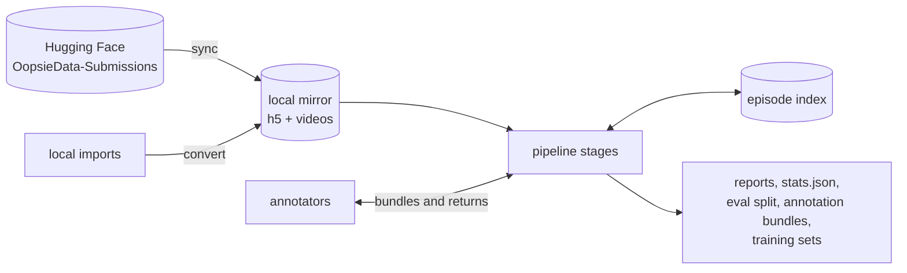

# Pipeline overview

The backend is built around two stores, the local mirror of the labs' data and the episode index, and a pipeline of stages that read from both and write their results to the index.



## The mirror

The mirror is a copy of every contributor and imported repo of the Hugging Face organization, kept on LS6 under `/corral/utexas/IRI26024/oopsiedata`. It is a superset of the Hub: the sync downloads new and changed files, and keeps files the Hub no longer has unless told to delete them. Datasets that are converted locally rather than uploaded live next to it, under `imports/`.

The h5 files in the mirror are the source of truth. No stage ever modifies them: labels, flags and corrections are stored in the index, and the annotated releases are written as separate copies.

## The episode index

`episode_index.parquet` is a table with one row per episode, keyed by `episode_key`, the first 16 hex characters of `sha1("<dataset_repo>/<repo_path>")`. The index build creates the rows and fills the core columns from the h5 files, and every later stage adds its results as its own columns: QA findings, duplicate links, the eval split, the collected annotations and so on. The [index column reference](../reference/index-columns.md) lists them all.

Because every result is a column, any question about the data is a filter on one table:

```python
import polars as pl

df = pl.read_parquet("episode_index.parquet")
usable = df.filter(
    pl.col("on_disk") & pl.col("public") & pl.col("duplicate_of").is_null() & ~pl.col("critical").fill_null(False)
)
```

Stages write through `oopsie_backend.index.store.update_columns`, which replaces only the stage's own columns for the episodes it computed and leaves every other column untouched. Each write takes an exclusive lock on `<index>.lock` and replaces the file atomically, so stages that run at the same time never lose each other's results.

## Repos

The index build discovers episodes under `<data_dir>/OopsieData-Submissions/<repo>/` and `<data_dir>/imports/<name>/`. Each repo has a kind that decides how the rest of the pipeline treats it:

| Kind | Repos | Treatment |
|---|---|---|
| `contributor` | every org repo not listed in a config | indexed, QA-checked and counted; public unless the lab id is a placeholder |
| `external` | the entries of `configs/imports.yaml` | indexed, QA-checked and usable for training, but never public and never counted toward the lab requirements |
| `archive` | frozen snapshots listed in `configs/repositories.yaml` | never synced or indexed |
| `infra` | site assets and the annotation repos, listed in `configs/repositories.yaml` | never synced or indexed |

## Stages

The pipeline is the sequence of steps that turns the labs' uploads into curated data: sync the Hub, build the index, check the data, choose the eval split, run the annotation and build training sets. Each step is a **stage**. Stages read the [episode index](index.md#the-episode-index) and write their results back to it as columns, or write files such as reports and annotation bundles.

[Apache Hamilton](https://hamilton.apache.org/) runs the stages. A stage declares the stages it depends on as function parameters, and Hamilton derives the order from these dependencies. It runs independent stages in parallel and skips a stage whose code and inputs are unchanged since its last run, so a nightly run only repeats work for what changed that day.


Boxes group the stages by the target that runs them. The `manual` stages never run on their own; each needs to be named explicitly, as described in [Running targets](running-targets.md#targets). The dashed edge is not a dependency: `imported_datasets` converts datasets into the mirror, where the next index build finds them. For readability, the graph leaves out the edges from the unification stages into training and the analysis.

| Stage | Does | Page |
|---|---|---|
| `hub_mirror` | downloads new and changed files from the Hub into the mirror | [Hub sync](sync.md) |
| `episode_index` | reads the h5 files and builds the index's core columns | [Episode index](episode-index.md) |
| `hub_upload_times` | records when each episode reached the Hub | [Hub sync](sync.md#upload-times) |
| `duplicate_episodes`, `duplicate_videos` | link copies of episodes and videos shared between episodes | [Duplicates](duplicates.md) |
| `unified_camera_names` | maps recorded camera names to a common set | [Camera names](camera-names.md) |
| `unified_embodiments` | maps robot and gripper names to unified arms and end effectors | [Embodiments](embodiments.md) |
| `unified_policies` | maps policy names to families and classes | [Policies](policies.md) |
| `qa_results` | checks actions, states and videos | [QA](qa/index.md) |
| `critical_episodes` | marks structurally unusable episodes | [Critical episodes](critical-episodes.md) |
| `stats` | computes the website and internal stats | [Stats](stats.md) |
| `eval_proposals`, `chosen_proposal`, `eval_split` | proposes eval splits, freezes the chosen one and records it in the index | [Eval split](eval-split.md) |
| `train_sample` | samples train episodes for annotation | [Train sample](train-sample.md) |
| `annotation_bundles`, `annotation_columns` | builds the annotation bundles, gives them to annotators and collects their labels into the index | [Annotation](annotation/index.md) |
| `annotation_flags` | finds problems the annotators reported and excludes affected episodes | [Annotation flags](annotation/flags.md) |
| `imported_datasets` (manual) | converts external datasets into the mirror | [Imported datasets](imports.md) |
| `training_data` (manual) | materializes a training set from a recipe | [Training data](training-data.md) |
| `dataset_analysis`, `annotation_analysis` (manual) | computes the statistics of the dataset paper | [Dataset analysis](analysis.md) |
| `data_release` (manual) | publishes a reproducible snapshot of the data and index | [Data releases](release.md) |

## Which episodes count

Three columns take episodes out of later steps, each for a different reason:

- **`duplicate_of`**: the episode is a copy of another one. Every downstream step skips copies, so each recording counts once.
- **`critical`**: the episode is structurally unusable, for example unreadable or with misaligned actions. The stats, split planning and training leave it out.
- **`annotation_excluded`**: the annotators reported a problem that makes the episode unusable, such as a cut-off recording. Training and the dataset analysis leave it out.

## Human decisions and guarantees

The eval split must never change once annotators have started on it. Two stages wait for a person; until the decision exists, they and the stages after them leave everything unchanged, and the log says what they are waiting for.

| Decision | Where | Waiting stages |
|---|---|---|
| which eval proposal to hold out, after reviewing `annotation/proposals/REPORT.md` | `chosen_proposal` in `configs/eval_split.yaml` | `chosen_proposal`, `eval_split`, `train_sample`, `annotation_bundles` |
| who annotates | `<data_dir>/annotation/annotators.txt`, one name per line; names added later get a train bundle | `annotation_bundles` |

Three rules then keep the split fixed:

- The chosen eval proposal, the annotated train sample and the first annotator assignments are **written once**, and every annotation bundle is final: the roster only records who holds it. Next to each output, a `<name>.inputs` file records the settings it was made from. Later runs keep the output, and fail rather than rewrite it when those settings change. To regenerate an output deliberately, delete it together with its `.inputs` file. Outputs copied in by hand are adopted as they are.
- Once a proposal is chosen, the proposal stage stops regenerating proposals, so changes to QA or to the critical conditions cannot alter them. Once frozen, the proposal is also kept in the backend repo and `chosen_proposal` names that file, so every `data_dir` holds the same split ([eval split](eval-split.md)).
- Episodes of a held-out lab or task that the proposal does not list, such as later uploads, are recorded as `excluded`, so they never reach the train side.
- Training keeps a held-out eval episode even if it becomes critical later. The only way an episode leaves the eval set is through the annotators' flags.

## Next

[Running](running.md) explains the two ways to run the stages.
