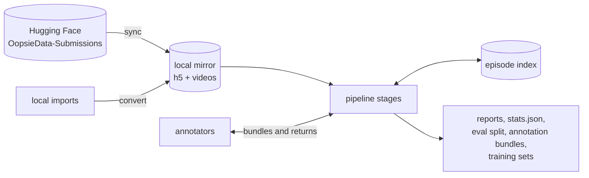

# Pipeline overview

The backend is built around two stores, the local mirror of the labs' data and the episode index, and a pipeline of stages that read from both and write their results to the index.



## The mirror

The mirror is a copy of every contributor and imported repo of the Hugging Face organization, kept on LS6 under `/corral/utexas/IRI26024/oopsiedata`. It is a superset of the Hub: the sync downloads new and changed files, and keeps files the Hub no longer has unless told to delete them. Datasets that are converted locally rather than uploaded live next to it, under `imports/`.

The h5 files in the mirror are the source of truth. No stage ever modifies them: labels, flags and corrections are stored in the index, and the annotated releases are written as separate copies.

## The episode index

`episode_index.parquet` is a table with one row per episode, keyed by `episode_key`, the first 16 hex characters of `sha1("<dataset_repo>/<repo_path>")`. The index build creates the rows and fills the core columns from the h5 files, and every later stage adds its results as its own columns: QA findings, duplicate links, the eval split, the collected annotations and so on. The [index column reference](../reference/index-columns.md) lists them all.

Because every result is a column, any question about the data is a filter on one table:

```python
import polars as pl

df = pl.read_parquet("episode_index.parquet")
usable = df.filter(
    pl.col("on_disk") & pl.col("public") & pl.col("duplicate_of").is_null() & ~pl.col("critical").fill_null(False)
)
```

Stages write through `oopsie_backend.index.store.update_columns`, which replaces only the stage's own columns for the episodes it computed and leaves every other column untouched. Each write takes an exclusive lock on `<index>.lock` and replaces the file atomically, so stages that run at the same time never lose each other's results.

## Repos

The index build discovers episodes under `<data_dir>/OopsieData-Submissions/<repo>/` and `<data_dir>/imports/<name>/`. Each repo has a kind that decides how the rest of the pipeline treats it:

| Kind | Repos | Treatment |
|---|---|---|
| `contributor` | every org repo not listed in a config | indexed, QA-checked and counted; public unless the lab id is a placeholder |
| `external` | the entries of `configs/imports.yaml` | indexed, QA-checked and usable for training, but never public and never counted toward the lab requirements |
| `archive` | frozen snapshots listed in `configs/repositories.yaml` | never synced or indexed |
| `infra` | site assets and the annotation repos, listed in `configs/repositories.yaml` | never synced or indexed |

## Which episodes count

Three columns take episodes out of later steps, each for a different reason:

- **`duplicate_of`**: the episode is a copy of another one. Every downstream step skips copies, so each recording counts once.
- **`critical`**: the episode is structurally unusable, for example unreadable or with misaligned actions. The stats, split planning and training leave it out.
- **`annotation_excluded`**: the annotators reported a problem that makes the episode unusable, such as a cut-off recording. Training and the dataset analysis leave it out.

## Human decisions and guarantees

The eval split must never change once annotators have started on it. Two stages wait for a person; until the decision exists, they and the stages after them leave everything unchanged, and the log says what they are waiting for.

| Decision | Where | Waiting stages |
|---|---|---|
| which eval proposal to hold out, after reviewing `annotation/proposals/REPORT.md` | `chosen_proposal` in `configs/eval_split.yaml` | `chosen_proposal`, `eval_split`, `train_sample`, `annotator_assignments` |
| who annotates | `<data_dir>/annotation/annotators.txt`, one name per line | `annotator_assignments` |

Three rules then keep the split fixed:

- The chosen eval proposal, the annotated train sample and the annotator assignments are **written once**. Next to each output, a `<name>.inputs` file records the settings it was made from. Later runs keep the output, and fail rather than rewrite it when those settings change. To regenerate an output deliberately, delete it together with its `.inputs` file. Outputs copied in by hand are adopted as they are.
- Once a proposal is chosen, the proposal stage stops regenerating proposals, so changes to QA or to the critical conditions cannot alter them.
- Training keeps a held-out eval episode even if it becomes critical later. The only way an episode leaves the eval set is through the annotators' flags.

## Next

[Running the pipeline](running.md) describes the stages, how to run them and how the cache decides what to rerun.
