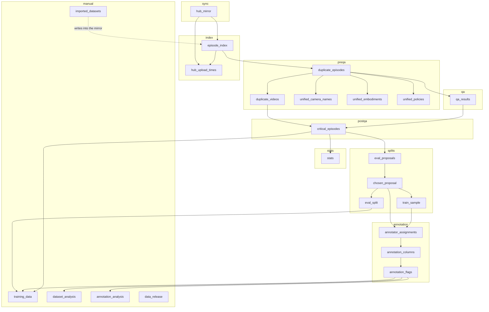

# Pipeline

The pipeline is the sequence of steps that turns the labs' uploads into curated data: sync the Hub, build the index, check the data, choose the eval split, run the annotation and build training sets. Each step is a **stage**. Stages read the [episode index](../architecture.md#the-episode-index) and write their results back to it as columns, or write files such as reports and annotation bundles.

[Apache Hamilton](https://hamilton.apache.org/) runs the stages. A stage declares the stages it depends on as function parameters, and Hamilton derives the order from these dependencies. It runs independent stages in parallel and skips a stage whose code and inputs are unchanged since its last run, so a nightly run only repeats work for what changed that day.

## Stages



Boxes group the stages by the target that runs them. The `manual` stages never run on their own; each needs to be named explicitly, as described [below](#targets). The dashed edge is not a dependency: `imported_datasets` converts datasets into the mirror, where the next index build finds them. For readability, the graph leaves out the edges from the unification stages into training and the analysis.

| Stage | Does | Page |
|---|---|---|
| `hub_mirror` | downloads new and changed files from the Hub into the mirror | [Hub sync](sync.md) |
| `episode_index` | reads the h5 files and builds the index's core columns | [Episode index](episode-index.md) |
| `hub_upload_times` | records when each episode reached the Hub | [Hub sync](sync.md#upload-times) |
| `duplicate_episodes`, `duplicate_videos` | link copies of episodes and videos shared between episodes | [Duplicates](duplicates.md) |
| `unified_camera_names` | maps recorded camera names to a common set | [Camera names](camera-names.md) |
| `unified_embodiments` | maps robot and gripper names to unified arms and end effectors | [Embodiments](embodiments.md) |
| `unified_policies` | maps policy names to families and classes | [Policies](policies.md) |
| `qa_results` | checks actions, states and videos | [QA](qa/index.md) |
| `critical_episodes` | marks structurally unusable episodes | [Critical episodes](critical-episodes.md) |
| `stats` | computes the website and internal stats | [Stats](stats.md) |
| `eval_proposals`, `chosen_proposal`, `eval_split` | proposes eval splits, freezes the chosen one and records it in the index | [Eval split](eval-split.md) |
| `train_sample` | samples train episodes for annotation | [Train sample](train-sample.md) |
| `annotator_assignments`, `annotation_columns` | assigns episodes to annotators and collects their labels into the index | [Annotation](annotation/index.md) |
| `annotation_flags` | finds problems the annotators reported and excludes affected episodes | [Annotation flags](annotation/flags.md) |
| `imported_datasets` (manual) | converts external datasets into the mirror | [Imported datasets](imports.md) |
| `training_data` (manual) | materializes a training set from a recipe | [Training data](training-data.md) |
| `dataset_analysis`, `annotation_analysis` (manual) | computes the statistics of the dataset paper | [Dataset analysis](analysis.md) |
| `data_release` (manual) | publishes a reproducible snapshot of the data and index | [Data releases](release.md) |

## Running

```bash
uv run oopsie pipeline run all --config configs/pipeline.yaml --explain   # the nightly run
uv run oopsie pipeline run qa                                             # one target and what it needs
uv run oopsie pipeline run --list                                         # targets and stages
```

Running a target also runs every stage it depends on, unless that stage's result is cached. `--explain` prints which stages ran and which came from the cache. Other options:

| Option | Effect |
|---|---|
| `--config FILE` | the inputs file, by default `configs/pipeline.yaml` |
| `--set KEY=VALUE` | overrides one input, e.g. `--set data_dir=/path/to/mirror` or `--set use_hub=false`; repeatable |
| `--no-cache` | reruns every requested stage |
| `--serial` | runs one stage at a time |
| `--graph FILE` | draws the stages of the target to an image |

Every stage is also a command that runs without the pipeline, with its own options (`uv run oopsie <stage> <command> --help`). The stage pages give these commands, and the [command reference](../reference/commands.md) lists them all.

### Targets

| Target | Stages |
|---|---|
| `all` | every stage except the manual ones; the nightly job runs this |
| `sync` | `hub_mirror` |
| `index` | `episode_index`, `hub_upload_times` |
| `preqa` | `duplicate_episodes`, `duplicate_videos`, `unified_camera_names`, `unified_embodiments`, `unified_policies` |
| `qa` | `qa_results` |
| `postqa` | `critical_episodes` |
| `stats` | `stats` |
| `proposals` | `eval_proposals` |
| `splits` | `eval_split`, `train_sample` |
| `annotation` | `annotation_flags` |
| `imports` | `imported_datasets` (manual) |
| `training` | `training_data` (manual); needs `--set training_recipe=configs/training/<recipe>.yaml` |
| `analysis` | `dataset_analysis`, `annotation_analysis` (manual); needs `uv sync --extra analysis` |
| `release` | `data_release` (manual); needs `--set release_snapshot=<sync report>` |

Manual stages are left out of `all` because they are expensive or need a decision: which dataset to convert, which recipe to build, when to publish a release.

### Inputs

`configs/pipeline.yaml` holds every input a stage may take. The defaults are the LS6 paths.

| Input | Meaning |
|---|---|
| `data_dir` | the mirror root |
| `index_path` | the episode index |
| `cache_dir` | Hamilton's cache |
| `workers` | parallel processes of the index build, QA and training |
| `use_hub` | whether to sync with the Hub and list Hub hashes; `false` works offline |
| `reports_dir` | where reports go |
| `stats_docs_output` | the website's `stats.json` |
| `split_config_path`, `annotation_config_path` | the eval split and annotation configs |
| `training_dir`, `training_work_dir`, `training_recipe` | where training sets are built and copied, and which recipe |
| `stage_dir` | fast storage where imported datasets are converted |
| `node_stage_dir` | node-local storage that QA and training copy episodes to before reading them |
| `release_snapshot`, `release_name` | the sync report a release is made from, and its name |

## What reruns

Hamilton keeps, for each stage, a version of the stage's code and a fingerprint of each of its inputs. When both match an earlier run, it returns the stored result instead of running the stage. A stage's result is itself a fingerprint of what it wrote, usually a hash of its index columns or output files, so a stage that reruns but produces the same output does not trigger the stages after it.

Hamilton cannot see files on its own. Small stages that run on every invocation (`@stage(always_run=True)`) therefore watch the outside state and return its hash:

| Watcher | Hashes |
|---|---|
| `mirror_state` | the path, size and modification time of every h5 file, and the repo and import configs |
| `camera_names_config`, `embodiments_config`, `policies_config`, `critical_config`, `stats_config`, `split_config`, `annotation_flags_config`, `analysis_config` | their config file |
| `qa_check_versions` | the version of every QA check |
| `annotation_state` | the annotation stores |
| `training_recipe_state` | the training recipe |

When a watched file changes, the stage after the watcher sees a new input and reruns. `hub_mirror` and `imported_datasets` also run every time, because only they can find out whether there is new data.

Hamilton versions a stage by the source of the stage function alone, not by the code it calls. Changes to that code are usually caught anyway: the index stages see changed files, and QA hashes its checks' code into their versions. After other code changes, run the affected target once with `--no-cache`.

## Human decisions

Two stages wait for a person. Until the decision exists, they and the stages after them leave everything unchanged, and the log says what they are waiting for.

| Decision | Where | Waiting stages |
|---|---|---|
| which eval proposal to hold out, after reviewing `annotation/proposals/REPORT.md` | `chosen_proposal` in `configs/eval_split.yaml` | `chosen_proposal`, `eval_split`, `train_sample`, `annotator_assignments` |
| who annotates | `<data_dir>/annotation/annotators.txt`, one name per line | `annotator_assignments` |

Annotators may already be working on the outputs that follow these decisions, so the chosen proposal, the train sample and the assignments are written once. Next to each output, a `<name>.inputs` file records the settings it was made from. Later runs keep the output, and fail if those settings changed instead of rewriting it. To regenerate an output deliberately, delete it together with its `.inputs` file. Outputs copied in by hand are adopted as they are.
