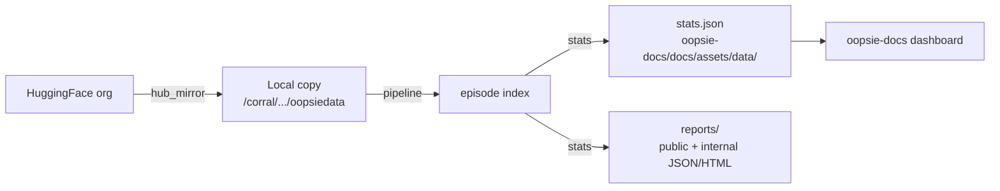

# Sync and stats

The LS6 daily job runs the [pipeline](pipeline.md), which first syncs the Hugging Face org datasets into the mirror on Corral. It then regenerates the dashboard `stats.json` consumed by the sibling [`oopsie-docs`](../../oopsie-docs) Jekyll site, and refreshes the episode index, QA results and critical flags.

Local storage is a **superset** of the Hub: new and changed files are downloaded, and files removed from the Hub are reported but kept unless the sync runs with `--delete-removed`.



## Prerequisites

`/corral/utexas/IRI26024` holds data only: the mirror, imports, training data, the episode index, reports and logs. TACC does not intend Corral for computation ([TACC's guidance](https://docs.tacc.utexas.edu/basics/userissues/)). Jobs therefore stage code, tools and caches into `$SCRATCH/oopsie`, and copy the episodes they read heavily to node-local disk before reading them. The canonical copies of the code are the git remotes.

| Staged in `$SCRATCH/oopsie` | By |
|---|---|
| `oopsie-backend/` (latest `main`) | the scron entry, before the job starts |
| `oopsie-docs/` (latest `main`) | the job; it commits and pushes `stats.json` when it changed |
| `tools/bin/uv`, `tools/uv-python`, `uv-cache/`, `hf_home/` | the job installs uv if missing |
| `training/` | training (`training_work_dir`): unified episodes and formats, before the finished dataset is copied to corral |
| `episodes/imports/` | imports (`stage_dir`): conversions in progress, moved to `oopsiedata/imports/` when done |

QA and training stage the episodes they read on each compute node's local disk (`node_stage_dir`, `/tmp/oopsie/episodes`), at most 1,000 episodes at a time; each chunk is removed when it is done.

A purge of `$SCRATCH` only means the next run downloads or copies these again. The index and pipeline cache stay on corral: few files change per run, and every job that writes the index uses the same copy.

One-time setup, by the member of group `G-829069` who runs the job:

1. Make sure the SSH key the jobs use can read `oopsie-backend` and push to `oopsie-docs` on GitHub.
2. Put the Hugging Face tokens next to the data (`master.hf_token` is the read token), readable by the group only:

    ```bash
    cp tokens.yaml /corral/utexas/IRI26024/oopsiedata/tokens.yaml
    chgrp G-829069 /corral/utexas/IRI26024/oopsiedata/tokens.yaml
    chmod 640 /corral/utexas/IRI26024/oopsiedata/tokens.yaml
    ```

3. Install the cron entry from any copy of [`slurm/daily.scron`](../slurm/daily.scron): `scrontab daily.scron`.

`tokens.yaml` lives in the data directory, not in the repo (it is in `.gitignore`). The job takes `master.hf_token` from it unless `HF_TOKEN` is set. Every path can be overridden with an environment variable: `OOPSIE_ROOT`, `OOPSIE_DATA_DIR`, `OOPSIE_INDEX_DIR`, `OOPSIE_REPORTS_DIR`, `OOPSIE_LOG_DIR`, `OOPSIE_TOKENS`, `OOPSIE_STAGE`, `OOPSIE_BACKEND`, `OOPSIE_DOCS`, `OOPSIE_DOCS_REMOTE`, `OOPSIE_DOCS_BRANCH`, `OOPSIE_GIT_EMAIL` and `UV`. If `oopsie-docs` cannot be fetched, `stats.json` is written to the reports directory and not published.

For manual runs, stage a checkout the same way and set the variables the job sets:

```bash
B=$SCRATCH/oopsie/oopsie-backend
git clone --depth 1 --branch main git@github.com:oopsie-data/oopsie-backend.git $B   # or: git -C $B pull
export UV_PYTHON_INSTALL_DIR=$SCRATCH/oopsie/tools/uv-python UV_CACHE_DIR=$SCRATCH/oopsie/uv-cache HF_HOME=$SCRATCH/oopsie/hf_home
export HF_TOKEN=<master.hf_token from /corral/utexas/IRI26024/oopsiedata/tokens.yaml>
cd $B
```

On LS6 `vm-small` nodes, numpy must stay below 2.4 (older CPUs lack x86-v2). The daily job handles this automatically; for manual runs:

```bash
uv add "numpy<2.4" && uv sync --reinstall-package numpy
```

## (Option 1) Daily Slurm job

Batch scripts live in [`slurm/`](../slurm/):

- [`daily_oopsie.slurm`](../slurm/daily_oopsie.slurm) — the full pipeline (`all` target), which starts with the sync
- [`daily.scron`](../slurm/daily.scron) — cron schedule (3:00 daily)
- [`pipeline.slurm`](../slurm/pipeline.slurm) — any pipeline target on a compute node, mainly the manual ones: `sbatch slurm/pipeline.slurm imports` or `sbatch slurm/pipeline.slurm training --set training_recipe=configs/training/<recipe>.yaml`, submitted from `$SCRATCH/oopsie/oopsie-backend`
- [`env.sh`](../slurm/env.sh) — the paths, tools and token setup both jobs share

Submit from anywhere:

```bash
sbatch $SCRATCH/oopsie/oopsie-backend/slurm/daily_oopsie.slurm
```

if vm-small is taking too long, try:

```bash
# check which nodes are free
sinfo -S+P -o "%18P %10l %20F"

# Use them
sbatch -p normal $SCRATCH/oopsie/oopsie-backend/slurm/daily_oopsie.slurm

# Can also reduce time for node which gives you quicker access
sbatch -p normal,vm-small -t 06:00:00 $SCRATCH/oopsie/oopsie-backend/slurm/daily_oopsie.slurm
```

Expected log structure (stdout and stderr merged into one file):

```
=== 2026-06-14T10:00:00-05:00 START: setup_numpy ===
...
=== 2026-06-14T10:00:05-05:00 SUCCESS: setup_numpy completed in 5s ===
=== 2026-06-14T10:00:05-05:00 START: pipeline ===
  Syncing 18 repo(s) of OopsieData-Submissions into /corral/utexas/IRI26024/oopsiedata/OopsieData-Submissions
  ...
=== 2026-06-14T10:20:00-05:00 SUCCESS: pipeline completed in 300s ===
=== 2026-06-14T10:20:00-05:00 SUCCESS: oopsie-daily completed in 1200s (job 12345) ===
```
Two useful outputs:
1. Logs: `/corral/utexas/IRI26024/logs/oopsie-daily-<jobid>.log`
2. Final report: `/corral/utexas/IRI26024/oopsiedata/.sync_report.json`

## (Option 2) Manual run

### 1. Sync

The pipeline's first stage, `hub_mirror`, syncs the mirror (`--set use_hub=false` skips it). To sync on its own:

```bash
cd $SCRATCH/oopsie/oopsie-backend
export HF_TOKEN=<master.hf_token from /corral/utexas/IRI26024/oopsiedata/tokens.yaml>
sg G-829069 -c "uv run oopsie ingest sync --data-dir /corral/utexas/IRI26024/oopsiedata"
```

For every repo of the org, the sync lists the Hub at the repo's current commit and compares each file with `.sync_state.parquet`, which records every synced file's Hub blob id, sha256, local size and modification time:

| Local file | Action |
|---|---|
| recorded, same blob on the Hub, same size and mtime | unchanged; the file is not read |
| changed on the Hub | downloaded |
| on disk but not recorded, or modified since | adopted if `huggingface_hub`'s `.cache/huggingface` metadata or the file's hash matches the Hub, else downloaded |
| missing | downloaded |
| recorded but no longer on the Hub | reported; deleted with `--delete-removed` |

Downloads go to a temporary name next to the target over plain HTTPS and are renamed into place, so an interrupted sync never leaves a partial file under the real name. The state file is written after every repo, so a rerun resumes. Nothing else is written next to the data: the `.cache/huggingface` folders that `snapshot_download` keeps (a metadata and a lock file per data file) are deleted from each repo once every file of the repo is recorded. This matters on Corral, which allows 200,000 files per allocated TB.

| Option | Effect |
|---|---|
| `--only REPO ...` | sync only these repos of the org |
| `--smallest N` | sync only the N smallest contributor repos with h5 files (local test mirrors) |
| `--dry-run` | report what would be downloaded; writes nothing |
| `--no-download` | check and adopt files and delete `.cache` folders; download nothing |
| `--state PATH` | keep the sync record (and the report) at `PATH` instead of the data directory, e.g. on `$SCRATCH` when Corral has no free files |
| `--scan-local` | also report untracked local files and repo folders the Hub no longer has |
| `--delete-removed` | delete local files the Hub no longer has |
| `--keep-hf-cache` | keep the `.cache/huggingface` folders |
| `--group G-829069` | set this group on every file and folder the sync creates |
| `--parallel-repos N` | repos processed at the same time, one per worker (default 4) |
| `--workers N` | parallel checks and downloads within a repo (default 4) |

#### Permissions

Synced data must be accessible to all members of group `G-829069`. The sync runs with umask `002`. Directories under `/corral/utexas/IRI26024` have the setgid bit, so new files and folders inherit the group; Corral accounts quota by group, and files of another group fail with `Disk quota exceeded`. Running commands under `sg G-829069` makes that group the default even where setgid is missing.

To fix existing data by hand, the owner of the files runs:

```bash
DATA_DIR=/corral/utexas/IRI26024/oopsiedata
find "$DATA_DIR" -user $USER ! -group G-829069 -exec chgrp -h G-829069 {} +
find "$DATA_DIR" -user $USER -type d ! -perm -g+s -exec chmod g+s {} +
```

#### Output

```
Syncing 18 repo(s) of OopsieData-Submissions into /corral/utexas/IRI26024/oopsiedata/OopsieData-Submissions
[1/18] OopsieData-Submissions/SomeLab: downloaded 12, adopted 0, unchanged 450, removed on Hub 0, failed 0 (35s)
...
Downloaded 12 file(s), adopted 0, unchanged 37041, removed on Hub 3, repos failed 0
```

The first sync of an existing `snapshot_download` mirror reports most files as adopted.

`<data_dir>/.sync_report.json` holds the totals and, per repo, the counts, the files removed on the Hub, untracked files (with `--scan-local`), and failures. `repos_not_on_hub` lists local repo folders the Hub no longer has. The nightly job fails at the end if `datasets_failed` is not 0.

### 2. Update the index and stats

```bash
uv run oopsie pipeline run all --config configs/pipeline.yaml --explain
```

This refreshes the [episode index](episode-index.md), the duplicate checks, QA and the critical flags, then computes the stats from the index. The stats leave out duplicate copies and critical episodes; the internal report lists the critical episodes per lab. To recompute only the stats from an existing index:

```bash
uv run oopsie stats compute-local --index episode_index.parquet --data-dir /corral/utexas/IRI26024/oopsiedata
```

#### Flags

| Flag | Default | Description |
|------|---------|-------------|
| `--no-public-report` | off | Skip `public_stats.html` |
| `--no-internal-output` | off | Skip internal JSON/HTML entirely |
| `--no-internal-report` | off | Skip `internal_stats.html` only |
| `--index` | `episode_index.parquet` | Episode index to read |

No `HF_TOKEN` required — reads the index and lists repo folders on disk.

Internal stats additionally make a **best-effort** call to the Hub (using a cached
`huggingface-cli login` token or `HF_TOKEN`, if either is set) to list every dataset
repo in the org and its true creation date, for the "All datasets" inventory in
`internal_stats.html` (sortable by created/episodes/hours; includes repos with zero
episodes, e.g. labs that registered but haven't submitted yet). If no token is
available or the Hub can't be reached, this is skipped silently and that inventory
falls back to each dataset's earliest-episode timestamp instead.

### Config: `configs/stats_config.yaml`

All of the following are edited there, not in code - changes take effect on the
next stats run:

- The placeholder lab ids omitted from public stats. Which repos are archives or
  infra is set in `configs/repositories.yaml`, and which are imported (external)
  datasets in `configs/imports.yaml`.
- The list of placeholder operator names (e.g. `pending_operator`, `unknown`),
  whose episodes are flagged in the dataset inventory.
- The alpha/beta lab requirement thresholds and on/off toggles that drive the
  colored status dot on each row of the "All datasets" inventory: a lab is
  "alpha" if any of its dataset repos predates `alpha_cutoff_date`, otherwise
  "beta"; a lab *passes* its tier if its episodes, summed over all of its
  datasets and operators, clear every *enabled* clause for that tier. `task_diversity` and
  `per_task_cap` are placeholders - not implemented yet, always disabled.

If the file is missing, the code falls back to built-in defaults matching the
shipped YAML.

The stats stage writes two things:
1. public and internal stats to `reports/` 
2. the public stats json to oopsie-docs.


## Paths (LS6)

| Variable / path | Purpose |
|-----------------|---------|
| `/corral/utexas/IRI26024/oopsiedata` | Root of synced local data |
| `/corral/utexas/IRI26024/oopsiedata/.sync_state.parquet` | Record of every synced file |
| `/corral/utexas/IRI26024/oopsiedata/.sync_report.json` | Last sync summary |
| `oopsie-docs` `docs/assets/data/stats.json` | Public dashboard stats, committed by the job (in `reports/` if the docs repo could not be fetched) |
| `/corral/utexas/IRI26024/reports/public_stats.json`, `.html` | Public stats copy and snapshot |
| `/corral/utexas/IRI26024/reports/internal_stats.json`, `.html` | Full internal stats (all repos; not published) |
| `/corral/utexas/IRI26024/reports/action_qa.json`, `.html` | QA summary |
| `/corral/utexas/IRI26024/episode_index/` | Episode index and pipeline cache |
| `/corral/utexas/IRI26024/oopsiedata/annotation/` | Annotation assignments, bundles, returns and stores |
| `/corral/utexas/IRI26024/oopsiedata/imports/` | Locally converted imported datasets ([imports](imports.md)) |
| `/corral/utexas/IRI26024/training/` | Materialized training data, one folder per recipe ([training data](training-data.md)) |
| `/corral/utexas/IRI26024/oopsiedata/tokens.yaml` | Hugging Face tokens (`master.hf_token` for the nightly job) |
| `$SCRATCH/oopsie/` | Staged code, docs checkout, uv, caches, staged episodes and training work directories |

