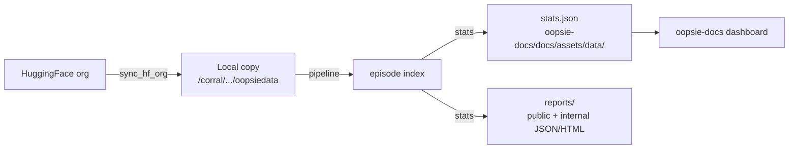

# Sync and stats

The LS6 daily job syncs Hugging Face org datasets to local scratch, then runs the [pipeline](pipeline.md): it regenerates the dashboard `stats.json` consumed by the sibling [`oopsie-docs`](../../oopsie-docs) Jekyll site, and refreshes the episode index, QA results and critical flags.

Local storage is a **superset** of the Hub: new and changed files are downloaded, but files removed from the Hub are kept on disk (reported as orphans). This is sync, not a strict mirror.



## Prerequisites

`/corral/utexas/IRI26024` holds data only: the mirror, the episode index, reports and logs. Code, tools and caches are staged into `$SCRATCH/oopsie` for every run, following [TACC's guidance](https://docs.tacc.utexas.edu/basics/userissues/) to keep job activity in `$SCRATCH`; their canonical copies are the git remotes.

| Staged in `$SCRATCH/oopsie` | By |
|---|---|
| `oopsie-backend/` (latest `main`) | the scron entry, before the job starts |
| `oopsie-docs/` (latest `main`) | the job; it commits and pushes `stats.json` when it changed |
| `tools/bin/uv`, `tools/uv-python`, `uv-cache/`, `hf_home/` | the job installs uv if missing |

A purge of `$SCRATCH` only means the next run downloads these again.

One-time setup, by the member of group `G-829069` who runs the job:

1. Make sure the SSH key the jobs use can read `oopsie-backend` and push to `oopsie-docs` on GitHub.
2. Put the Hugging Face tokens next to the data (`master.hf_token` is the read token), readable by the group only:

    ```bash
    cp tokens.yaml /corral/utexas/IRI26024/oopsiedata/tokens.yaml
    chgrp G-829069 /corral/utexas/IRI26024/oopsiedata/tokens.yaml
    chmod 640 /corral/utexas/IRI26024/oopsiedata/tokens.yaml
    ```

3. Install the cron entry from any copy of [`slurm/daily.scron`](../slurm/daily.scron): `scrontab daily.scron`.

`tokens.yaml` lives in the data directory, not in the repo (it is in `.gitignore`). The job takes `master.hf_token` from it unless `HF_TOKEN` is set. Every path can be overridden with an environment variable: `OOPSIE_ROOT`, `OOPSIE_DATA_DIR`, `OOPSIE_INDEX_DIR`, `OOPSIE_REPORTS_DIR`, `OOPSIE_LOG_DIR`, `OOPSIE_TOKENS`, `OOPSIE_STAGE`, `OOPSIE_BACKEND`, `OOPSIE_DOCS`, `OOPSIE_DOCS_REMOTE`, `OOPSIE_DOCS_BRANCH`, `OOPSIE_GIT_EMAIL` and `UV`. If `oopsie-docs` cannot be fetched, `stats.json` is written to the reports directory and not published.

For manual runs, stage a checkout the same way and set the variables the job sets:

```bash
B=$SCRATCH/oopsie/oopsie-backend
git clone --depth 1 --branch main git@github.com:oopsie-data/oopsie-backend.git $B   # or: git -C $B pull
export UV_PYTHON_INSTALL_DIR=$SCRATCH/oopsie/tools/uv-python UV_CACHE_DIR=$SCRATCH/oopsie/uv-cache HF_HOME=$SCRATCH/oopsie/hf_home
export HF_TOKEN=<master.hf_token from /corral/utexas/IRI26024/oopsiedata/tokens.yaml>
cd $B
```

On LS6 `vm-small` nodes, numpy must stay below 2.4 (older CPUs lack x86-v2). The daily job handles this automatically; for manual runs:

```bash
uv add "numpy<2.4" && uv sync --reinstall-package numpy
```

## (Option 1) Daily Slurm job

Batch scripts live in [`slurm/`](../slurm/):

- [`daily_oopsie.slurm`](../slurm/daily_oopsie.slurm) — sync, then the `nightly` pipeline target
- [`daily.scron`](../slurm/daily.scron) — cron schedule (3:00 daily)

Submit from anywhere:

```bash
sbatch $SCRATCH/oopsie/oopsie-backend/slurm/daily_oopsie.slurm
```

if vm-small is taking too long, try:

```bash
# check which nodes are free
sinfo -S+P -o "%18P %10l %20F"

# Use them
sbatch -p normal $SCRATCH/oopsie/oopsie-backend/slurm/daily_oopsie.slurm

# Can also reduce time for node which gives you quicker access
sbatch -p normal,vm-small -t 06:00:00 $SCRATCH/oopsie/oopsie-backend/slurm/daily_oopsie.slurm
```

Expected log structure (stdout and stderr merged into one file):

```
=== 2026-06-14T10:00:00-05:00 START: setup_numpy ===
...
=== 2026-06-14T10:00:05-05:00 SUCCESS: setup_numpy completed in 5s ===
=== 2026-06-14T10:00:05-05:00 START: sync_hf_org ===
  Syncing 18 dataset(s) under 'OopsieData-Submissions'
  ...
=== 2026-06-14T10:15:00-05:00 SUCCESS: sync_hf_org completed in 895s ===
=== 2026-06-14T10:15:00-05:00 START: pipeline ===
  ...
=== 2026-06-14T10:20:00-05:00 SUCCESS: pipeline completed in 300s ===
=== 2026-06-14T10:20:00-05:00 SUCCESS: oopsie-daily completed in 1200s (job 12345) ===
```
Two useful outputs:
1. Logs: `/corral/utexas/IRI26024/logs/oopsie-daily-<jobid>.log`
2. Final report: `/corral/utexas/IRI26024/oopsiedata/.sync_report.json`

## (Option 2) Manual run (two steps)

### 1. Sync

```bash
cd $SCRATCH/oopsie/oopsie-backend

export HF_TOKEN=<master.hf_token from /corral/utexas/IRI26024/oopsiedata/tokens.yaml>   # required for private org datasets
export HF_HUB_DISABLE_XET=1   # this avoids reaching HUB API limits!

uv run python -m oopsie_backend.ingest.sync \
  --org OopsieData-Submissions \
  --local-dir /corral/utexas/IRI26024/oopsiedata \
  --group G-829069 \
  --verbose
```
Note: Currently we are using snapshot_download, might have to switch to git clone/git pull in order to avoid hitting the API limits and making the script run faster

#### Permissions

Synced data must be accessible to all members of group `G-829069`. The sync runs with umask `002`, and with `--group G-829069` it additionally assigns every path under `--local-dir` it owns to that group. Files get group read/write, and directories get group `rwx` plus setgid, so new files inherit the group. Paths owned by other users are skipped. Those paths need a one-off `chgrp -R G-829069` by their owner. The daily Slurm job passes `--group G-829069` and also sets the group on `$DATA_DIR` before syncing.

To fix existing data by hand, the owner of the files runs:

```bash
DATA_DIR=/corral/utexas/IRI26024/oopsiedata
chgrp -R G-829069 "$DATA_DIR"
chmod -R g+rwX "$DATA_DIR"
find "$DATA_DIR" -type d -exec chmod g+s {} +
```

`g+rwX` gives the group execute permission only on directories and on files that are already executable. To find paths that still have the wrong group, run `find "$DATA_DIR" ! -group G-829069`.

#### Expected stderr output

##### Default (no `--verbose`)

```
  Syncing 18 dataset(s) under 'OopsieData-Submissions'
  [1/18] OopsieData-Submissions/SomeLab  downloaded 12, skipped 450, took 2m 15s
  [2/18] OopsieData-Submissions/OtherLab  downloaded 0, skipped 1203, took 45.2s
  ...

  Downloaded: 12 file(s), skipped (unchanged): 37041, datasets: 18, orphans kept: 847, errors: 0
  Report: /corral/utexas/IRI26024/oopsiedata/.sync_report.json
```

When already fully synced, `downloaded` is 0 and `skipped` is high.

##### With `--verbose`

```
  Syncing 18 dataset(s) under 'OopsieData-Submissions'
  [1/18] OopsieData-Submissions/SomeLab
    dest: /corral/utexas/IRI26024/oopsiedata/OopsieData-Submissions/SomeLab
    downloaded 12, skipped 450, took 2m 15s

  Checking orphans...
  OopsieData-Submissions/SomeLab: 3 orphan(s)

  Downloaded: 12 file(s), skipped (unchanged): 37041, datasets: 18, orphans kept: 847, errors: 0
  Report: /corral/utexas/IRI26024/oopsiedata/.sync_report.json
```

##### Sync report (`.sync_report.json`)

Written to `<local-dir>/.sync_report.json` after every run.

Example (truncated):

```json
{
  "org": "OopsieData-Submissions",
  "local_dir": "/corral/utexas/IRI26024/oopsiedata",
  "dry_run": false,
  "synced_at": {
    "utc": "2026-06-14T16:22:34Z",
    "cdt": "2026-06-14T11:22:34-05:00"
  },
  "datasets_synced": 18,
  "files_downloaded": 0,
  "files_skipped": 37053,
  "orphans_kept": [
    "OopsieData-Submissions/UT_RobIn/20260422_220912.h5",
    "OopsieData-Submissions/UT_RobIn/20260422_220912_left.mp4"
  ],
  "errors": [],
  "datasets": [
    "OopsieData-Submissions/SomeLab",
    "OopsieData-Submissions/OtherLab"
  ]
}
```


### 2. Update the index and stats

```bash
uv run oopsie pipeline run nightly --config configs/pipeline.yaml --explain
```

This refreshes the [episode index](episode-index.md), the duplicate checks, QA and the critical flags, then computes the stats from the index. The stats leave out duplicate copies and critical episodes; the internal report lists the critical episodes per lab. To recompute only the stats from an existing index:

```bash
uv run oopsie stats compute-local --index episode_index.parquet --data-dir /corral/utexas/IRI26024/oopsiedata
```

#### Flags

| Flag | Default | Description |
|------|---------|-------------|
| `--no-public-report` | off | Skip `public_stats.html` |
| `--no-internal-output` | off | Skip internal JSON/HTML entirely |
| `--no-internal-report` | off | Skip `internal_stats.html` only |
| `--index` | `episode_index.parquet` | Episode index to read |

No `HF_TOKEN` required — reads the index and lists repo folders on disk.

Internal stats additionally make a **best-effort** call to the Hub (using a cached
`huggingface-cli login` token or `HF_TOKEN`, if either is set) to list every dataset
repo in the org and its true creation date, for the "All datasets" inventory in
`internal_stats.html` (sortable by created/episodes/hours; includes repos with zero
episodes, e.g. labs that registered but haven't submitted yet). If no token is
available or the Hub can't be reached, this is skipped silently and that inventory
falls back to each dataset's earliest-episode timestamp instead.

### Config: `configs/stats_config.yaml`

All of the following are edited there, not in code - changes take effect on the
next stats run:

- The placeholder lab ids omitted from public stats. Which repos are archives,
  external datasets or infra is set in `configs/repositories.yaml`.
- The list of placeholder operator names (e.g. `pending_operator`, `unknown`) that
  never count as a real individual.
- The alpha/beta lab requirement thresholds and on/off toggles that drive the
  colored status dot on each row of the "All datasets" inventory: a lab is
  "alpha" if any of its dataset repos predates `alpha_cutoff_date`, otherwise
  "beta"; a lab *passes* its tier if even one individual clears every *enabled*
  clause for that tier (never summed across people). `task_diversity` and
  `per_task_cap` are placeholders - not implemented yet, always disabled.

If the file is missing, the code falls back to built-in defaults matching the
shipped YAML.

The stats stage writes two things:
1. public and internal stats to `reports/` 
2. the public stats json to oopsie-docs.


## Paths (LS6)

| Variable / path | Purpose |
|-----------------|---------|
| `/corral/utexas/IRI26024/oopsiedata` | Root of synced local data |
| `/corral/utexas/IRI26024/oopsiedata/.sync_report.json` | Last sync summary |
| `oopsie-docs` `docs/assets/data/stats.json` | Public dashboard stats, committed by the job (in `reports/` if the docs repo could not be fetched) |
| `/corral/utexas/IRI26024/reports/public_stats.json`, `.html` | Public stats copy and snapshot |
| `/corral/utexas/IRI26024/reports/internal_stats.json`, `.html` | Full internal stats (all repos; not published) |
| `/corral/utexas/IRI26024/reports/action_qa.json`, `.html` | QA summary |
| `/corral/utexas/IRI26024/episode_index/` | Episode index and pipeline cache |
| `/corral/utexas/IRI26024/oopsiedata/annotation/` | Annotation assignments, bundles, returns and stores |
| `/corral/utexas/IRI26024/oopsiedata/tokens.yaml` | Hugging Face tokens (`master.hf_token` for the nightly job) |
| `$SCRATCH/oopsie/` | Staged code, docs checkout, uv and caches |

