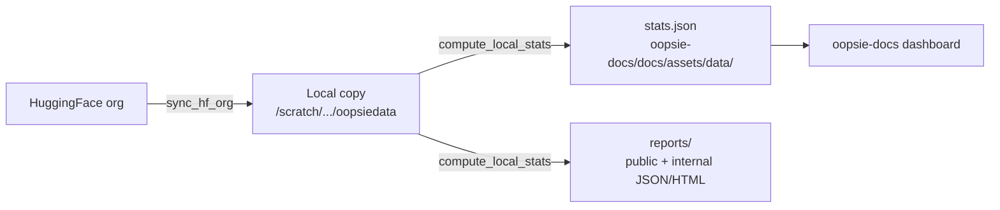

# Sync and stats

The LS6 daily job syncs Hugging Face org datasets to local scratch, then regenerates the dashboard `stats.json` consumed by the sibling [`oopsie-docs`](../../oopsie-docs) Jekyll site.

Local storage is a **superset** of the Hub: new and changed files are downloaded, but files removed from the Hub are kept on disk (reported as orphans). This is sync, not a strict mirror.



## Prerequisites

From the `oopsie-backend` directory:

```bash
cd /work/09666/abahety/ls6/oopsie-backend
uv sync
```

Set a Hugging Face read token before running sync (or remote stats):

```bash
export HF_TOKEN=hf_...
# or: export HF_TOKEN="$(tr -d '[:space:]' < "$HOME/.hf_token")"
```

On LS6 `vm-small` nodes, numpy must stay below 2.4 (older CPUs lack x86-v2). The daily job handles this automatically; for manual runs:

```bash
uv add "numpy<2.4" && uv sync --reinstall-package numpy
```

## Paths (LS6)

| Variable / path | Purpose |
|-----------------|---------|
| `/scratch/09666/abahety/oopsiedata` | Root of synced local data |
| `/scratch/09666/abahety/oopsiedata/.sync_report.json` | Last sync summary |
| `/work/09666/abahety/ls6/oopsie-docs/docs/assets/data/stats.json` | Public dashboard stats (docs site) |
| `/work/09666/abahety/ls6/oopsie-backend/reports/public_stats.json` | Public stats copy (backend) |
| `/work/09666/abahety/ls6/oopsie-backend/reports/internal_stats.json` | Full internal stats (all repos; not published) |
| `OOPSIE_STATS_OUT` | Override default docs-site `stats.json` path (`--docs-output`) |

Directory layout matches Hub paths:

```
<local-dir>/<namespace>/<repo-name>/<files...>
```

Example: `/scratch/09666/abahety/oopsiedata/OopsieData-Submissions/UT_RobIn/episode.h5`

## Manual run (two steps)

```bash
cd /work/09666/abahety/ls6/oopsie-backend

uv run python -m oopsie_backend.scripts.sync_hf_org \
  --org OopsieData-Submissions \
  --local-dir /scratch/09666/abahety/oopsiedata \
  --verbose

uv run python -m oopsie_backend.scripts.compute_local_stats \
  --data-dir /scratch/09666/abahety/oopsiedata
```

`compute_local_stats` writes public stats to `reports/` and the docs site by default. Override the docs JSON with `--docs-output` or `OOPSIE_STATS_OUT`.

## Daily Slurm job

Batch scripts live in [`slurm/`](../slurm/):

- [`daily_oopsie.slurm`](../slurm/daily_oopsie.slurm) — sync + stats
- [`daily.scron`](../slurm/daily.scron) — cron schedule (3:00 daily)

Submit from anywhere:

```bash
sbatch /work/09666/abahety/ls6/oopsie-backend/slurm/daily_oopsie.slurm
```

Expected log structure (stdout and stderr merged into one file):

```
=== 2026-06-14T10:00:00-05:00 START: setup_numpy ===
...
=== 2026-06-14T10:00:05-05:00 SUCCESS: setup_numpy completed in 5s ===
=== 2026-06-14T10:00:05-05:00 START: sync_hf_org ===
  Syncing 18 dataset(s) under 'OopsieData-Submissions'
  ...
=== 2026-06-14T10:15:00-05:00 SUCCESS: sync_hf_org completed in 895s ===
=== 2026-06-14T10:15:00-05:00 START: compute_local_stats ===
  ...
=== 2026-06-14T10:20:00-05:00 SUCCESS: compute_local_stats completed in 300s ===
=== 2026-06-14T10:20:00-05:00 SUCCESS: oopsie-daily completed in 1200s (job 12345) ===
```

Logs: `/scratch/09666/abahety/logs/oopsie-daily-<jobid>.log`

## Script reference

| Script | Doc | When to use |
|--------|-----|-------------|
| `sync_hf_org` | [sync-hf-org.md](sync-hf-org.md) | Sync HF org datasets to local disk |
| `compute_local_stats` | [compute-stats.md](compute-stats.md#compute_local_stats) | Stats from synced local data (production path) |
| `compute_hf_stats` | [compute-stats.md](compute-stats.md#compute_hf_stats) | Stats streamed from HF without a local copy |

